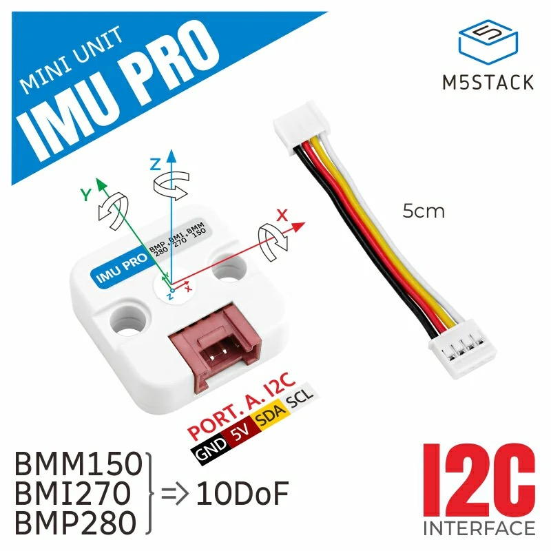
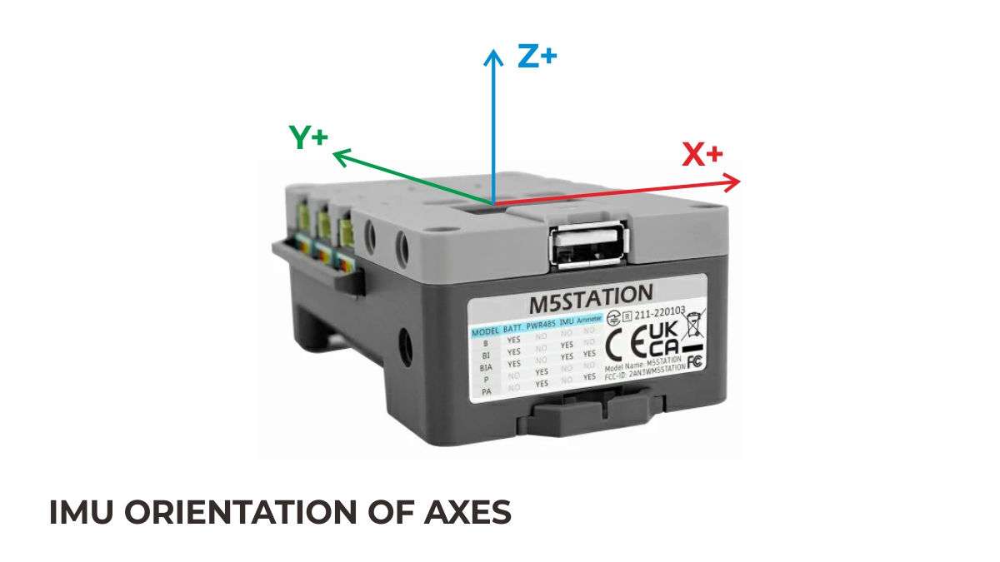
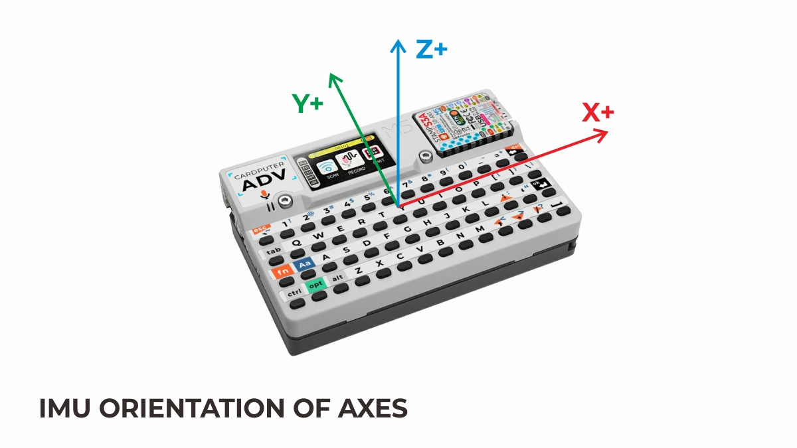

# IMU orientation diagrams

Axis-orientation ("IMU 三軸方向") reference images for M5Stack IMU units and for the hosts with a
built-in IMU, collected from the official M5Stack documentation. Use them to set the correct axis
remap (`ahrs.writeAxisOrder` / `m5::imu::presets::*`).

Notes:
- Gray and Fire share the same MPU6886 + BMM150 axis diagram (identical layout).
- Several classic hosts (Gray, Fire, the original StickC) shipped **earlier IMU generations**
  (MPU6050 + MAG3110, MPU9250 + AK8963, SH200Q + BMM150) that the current product pages no longer
  illustrate. Those revisions are listed below **text-only** (no orientation image); their axis remap
  must be confirmed on the original hardware before a preset is committed.
- Some hosts changed their IMU chip across hardware revisions without changing what M5.getBoard()
  reports (Core2 v1.1 MPU6886 → v1.3 BMI270; ATOM Matrix → v1.1 BMI270). AhrsDemo probes the
  internal bus (`m5::unit::imu::detectBuiltinImu`) to pick the accel/gyro driver, while the axis
  remap is still selected by board (the mounting orientation is a board property).
- Images are © M5Stack, reproduced here for development reference. Some were converted to JPEG
  (UnitMiniIMU and Gray/Fire were originally .webp).

# Units (external, GROVE)

## UnitMiniIMU (U095) — MPU6886 (0x68)

[Source](https://docs.m5stack.com/en/unit/imu)

## Unit Mini IMU-Pro (U171) — BMI270 (0x68) + BMM150 (0x10) + BMP280 (0x76)

The predecessor of the DoF series: BMI270 + BMM150 + BMP280 directly on the GROVE main bus
(driver: `UnitMiniIMUPro` composite). Pressure is read directly via `UnitMiniIMUPro::baro()`
(not part of the attitude AHRS; the UnitBMP280 driver comes from M5Unit-ENV).

[Source](https://docs.m5stack.com/en/unit/IMU%20Pro%20Mini%20Unit)

## Unit DoF6 / DoF9 / DoF10 (U228 / U229 / U230) — no orientation image

No product orientation image is published. The BMI270's accel/gyro axes are the same as
UnitMiniIMU's (confirmed by M5Stack, and measured on a DoF9): with the label facing up and the
GROVE connector nearest to you, **+X points right, +Y away from the connector, +Z up out of the
label face**. All three products share one PCB design, so this applies to DoF6, DoF9 and DoF10.

The BMM350 on DoF9/DoF10 does not share that frame -- its axes are rotated 180 degrees about X.
`m5::imu::presets::unitDoF()` applies the correction. DoF6 needs no preset.

## Unit BMM350 (U231) — BMM350 (0x14) — no orientation image

A standalone magnetometer, typically paired with a UnitMiniIMU for 9-axis. No product orientation
image is published; measured on hardware, its BMM350 needs the same correction as the DoF boards --
**rotated 180 degrees about X** relative to the unit's own frame:

    body = (mag_x, -mag_y, -mag_z)

`m5::imu::presets::unitBMM350()` applies it, and AhrsDemo calls that preset. Orient this unit the
same way as its accel/gyro partner (label up, GROVE connector nearest, +X right); a UnitMiniIMU
partner needs no correction of its own.

# Built-in hosts

## Core2 — MPU6886 (0x68)

[Source](https://docs.m5stack.com/en/core/core2)

## Core2 for AWS — MPU6886 (0x68)

[Source](https://docs.m5stack.com/en/core/core2_for_aws)

## Core2 v1.1 — MPU6886 (0x68)

[Source](https://docs.m5stack.com/en/core/Core2%20v1.1)

## Core2 v1.3 — BMI270 (0x68)

Note: v1.3 switched the IMU from MPU6886 to a 6-axis BMI270 (still no magnetometer).

[Source](https://docs.m5stack.com/en/core/Core2_v1.3)

## Station — MPU6886 (0x68)

6-axis MPU6886 (no magnetometer). M5Unified applies no axis correction (identity remap).

[Source](https://docs.m5stack.com/en/core/station_bat)

## CoreS3 / CoreS3-Lite — BMI270 (0x69) + BMM150 (0x10, AUX)

[Source](https://docs.m5stack.com/en/core/CoreS3)

## Fire — MPU6886 (0x68) + BMM150 (0x10)

Applies to the 2019.8–2021.7 generation. From v2.6 (2021.8) the BMM150 magnetometer was removed;
v2.6/v2.7 are 6-axis MPU6886 only (see below).

[Source](https://docs.m5stack.com/en/core/fire)

## Fire v2.6 / v2.7 — MPU6886 (0x68), 6-axis only (no magnetometer)

v2.6 (2021.8) removed the BMM150; v2.6 and v2.7 share the same 6-axis MPU6886 configuration (the
v2.6 page has no orientation image, so the v2.7 diagram applies to both).

[Source](https://docs.m5stack.com/en/core/fire_v2.7)

## Fire — early revisions (no orientation image)

The diagrams above cover the 2019.8+ MPU6886 generation. Earlier Fire hardware used different chips
and the current product page carries no orientation diagram for them:

- **original (≤ 2019.6)** — MPU9250 (0x68, WHO_AM_I 0x71) + internal **AK8963** (0x0C, reached via the
  MPU9250 aux bypass). Driver: `UnitMPU9250` composite (its `mag()` is the AK8963). Same generation as
  the 2017.12–2019.6 Gray.
- **2019.7** — **SH200Q** (0x6C) + BMM150 (0x10). Driver: `UnitSH200Q` + `UnitBMM150`.

Axis remap for both is unverified (no image, no M5Unified reference table); confirm on original
hardware before committing a preset.

## Gray — MPU6886 (0x68) + BMM150 (0x10)

[Source](https://docs.m5stack.com/en/core/gray)

## Gray — early revisions (no orientation image)

The diagram above is the 2019.6+ MPU6886 + BMM150 layout. Per the
[Gray update history](https://docs.m5stack.com/en/core/gray), earlier Gray hardware used different
chips, for which the current product page carries no orientation diagram:

- **2017 (original)** — MPU6050 (0x68) + **MAG3110** (0x0E). Two separate chips on the internal bus
  (no aux bypass). Driver: `UnitMPU6050` + `UnitMAG3110`.
- **2017.12 – 2019.6** — MPU9250 (0x68, WHO_AM_I 0x71) + internal **AK8963** (0x0C via the MPU9250 aux
  bypass). Driver: `UnitMPU9250` composite. Same generation as the original Fire.

Axis remap for both is unverified; confirm on original hardware before committing a preset.

## AtomMatrix — MPU6886 (0x68); v1.1 — BMI270 (0x68)

Note: ATOM Matrix v1.1 switched the IMU from MPU6886 to a 6-axis BMI270 (still no magnetometer, same
0x68 address and same mounting orientation, so the axis remap is unchanged across the swap). Because
M5.getBoard() cannot tell the generations apart, AhrsDemo probes the chip on the internal bus
(`m5::unit::imu::detectBuiltinImu`) to construct the right driver.

[Source](https://docs.m5stack.com/en/core/ATOM%20Matrix) · [v1.1](https://docs.m5stack.com/en/core/Atom-Matrix_v1.1)

## AtomS3 — MPU6886 (0x68)

[Source](https://docs.m5stack.com/en/core/AtomS3)

## AtomS3R (+CAM/Ext/M12) — BMI270 (0x68)

[Source](https://docs.m5stack.com/en/core/AtomS3R)

## StickC (original) — SH200Q (0x6C) → MPU6886 (0x68) (no orientation image)

The original M5StickC changed its IMU across production runs; the current product page shows no
per-generation orientation diagram:

- **2019.3** — **SH200Q** (0x6C). Driver: `UnitSH200Q`.
- **2019.8+** — MPU6886 (0x68). Driver: `UnitMPU6886`.

Axis remap for the SH200Q generation is unverified -- field reports even suggest its accel and gyro
axis systems may not agree with each other, so it stays at identity until confirmed on 2019
hardware. (StickC-Plus / StickC-Plus2 below are MPU6886 throughout.)

## StickC-Plus — MPU6886 (0x68)

[Source](https://docs.m5stack.com/en/core/m5stickc_plus)

## StickC-Plus2 — MPU6886 (0x68)

[Source](https://docs.m5stack.com/en/core/M5StickC%20PLUS2)

## StickS3 — BMI270 (0x68)

[Source](https://docs.m5stack.com/en/arduino/m5sticks3/imu)

## Capsule — BMI270 (0x69)

[Source](https://docs.m5stack.com/en/core/M5Capsule)

## Cardputer-Adv — BMI270 (0x68)

6-axis BMI270 (no magnetometer). M5Unified applies no axis correction (identity remap).

[Source](https://docs.m5stack.com/en/core/Cardputer-Adv)

## PaperS3 — BMI270 (0x68)

[Source](https://docs.m5stack.com/en/core/papers3)

## Nesso N1 (Arduino) — BMI270 (0x68)

ESP32-C6 host; 6-axis BMI270 on the internal system bus (no magnetometer). M5Unified applies no axis
correction on the C6, so AhrsDemo uses the identity remap (the BMI270 default path). The product
page has no dedicated IMU-orientation diagram.

[Source](https://docs.m5stack.com/en/core/Arduino_Nesso_N1)

## Tab5 — BMI270 (0x68)

ESP32-P4 host; 6-axis BMI270 on the internal system bus (no magnetometer). M5Unified applies no axis
correction on the P4, so AhrsDemo uses the identity remap. The product page has no dedicated
IMU-orientation diagram.

[Source](https://docs.m5stack.com/en/core/Tab5)
