# IMU orientation diagrams

Axis-orientation ("IMU 三軸方向") reference images for M5Stack IMU units and for the hosts with a
built-in IMU, collected from the official M5Stack documentation. Use them to set the correct axis
remap (`ahrs.writeAxisOrder` / `m5::imu::presets::*`).

Notes:
- Gray and Fire share the same MPU6886 + BMM150 axis diagram (identical layout).
- Images are © M5Stack, reproduced here for development reference. Some were converted to JPEG
  (UnitMiniIMU and Gray/Fire were originally .webp).

# Units (external, GROVE)

## UnitMiniIMU (U095) — MPU6886 (0x68)

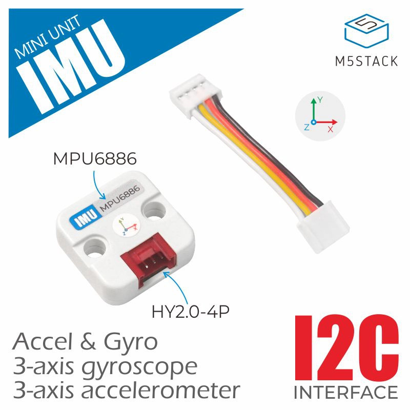

[Source](https://docs.m5stack.com/en/unit/imu)

# Built-in hosts

## Core2 — MPU6886 (0x68)

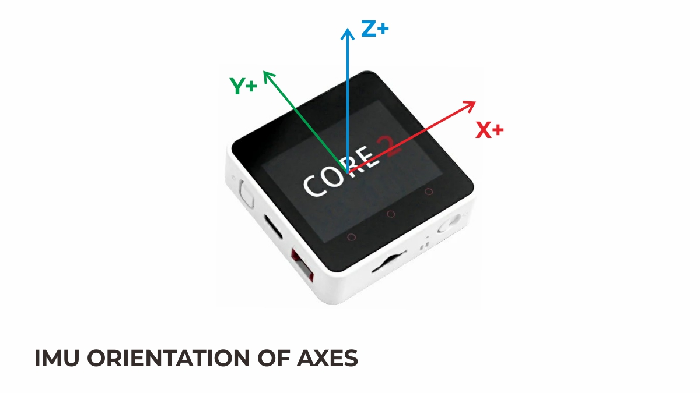

[Source](https://docs.m5stack.com/en/core/core2)

## Core2 for AWS — MPU6886 (0x68)

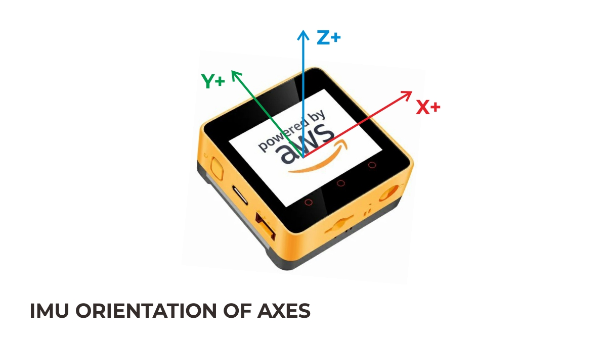

[Source](https://docs.m5stack.com/en/core/core2_for_aws)

## Core2 v1.1 — MPU6886 (0x68)

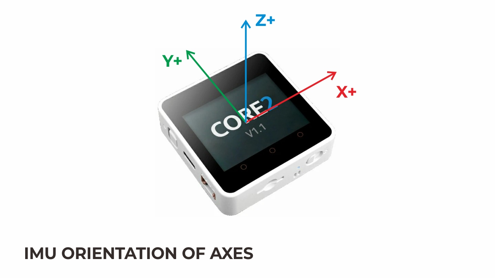

[Source](https://docs.m5stack.com/en/core/Core2%20v1.1)

## Core2 v1.3 — BMI270 (0x68)

Note: v1.3 switched the IMU from MPU6886 to a 6-axis BMI270 (still no magnetometer).

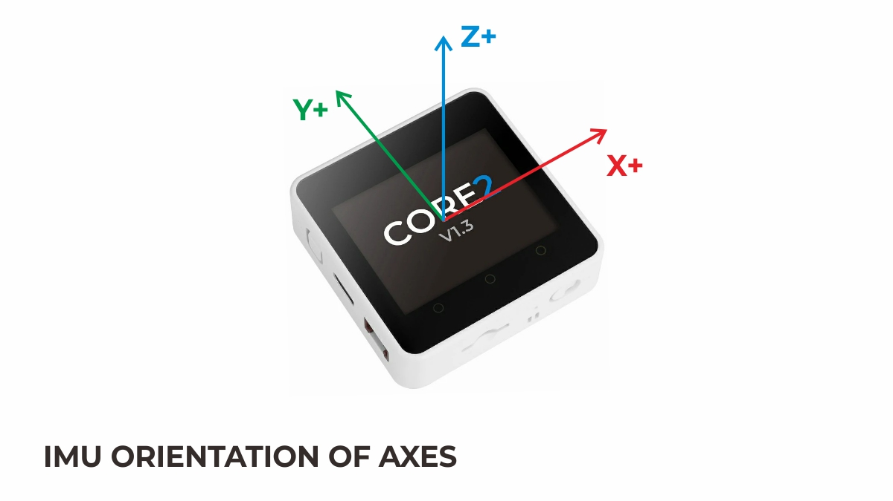

[Source](https://docs.m5stack.com/en/core/Core2_v1.3)

## CoreS3 / CoreS3-Lite — BMI270 (0x69) + BMM150 (0x10, AUX)

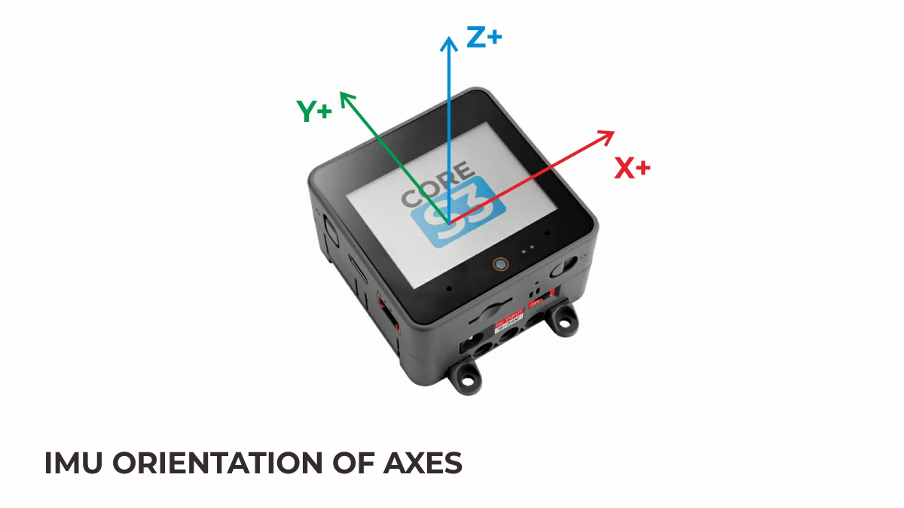

[Source](https://docs.m5stack.com/en/core/CoreS3)

## Fire — MPU6886 (0x68) + BMM150 (0x10)

Applies to the 2019.8–2021.7 generation. From v2.6 (2021.8) the BMM150 magnetometer was removed;
v2.6/v2.7 are 6-axis MPU6886 only (see below).

[Source](https://docs.m5stack.com/en/core/fire)

## Fire v2.6 / v2.7 — MPU6886 (0x68), 6-axis only (no magnetometer)

v2.6 (2021.8) removed the BMM150; v2.6 and v2.7 share the same 6-axis MPU6886 configuration (the
v2.6 page has no orientation image, so the v2.7 diagram applies to both).

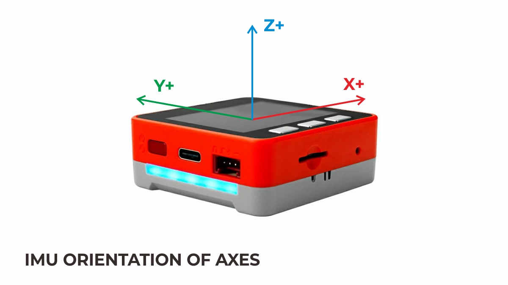

[Source](https://docs.m5stack.com/en/core/fire_v2.7)

## Gray — MPU6886 (0x68) + BMM150 (0x10)

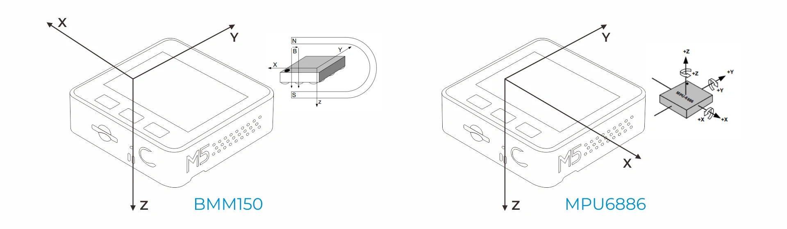

[Source](https://docs.m5stack.com/en/core/gray)

## AtomMatrix — MPU6886 (0x68)

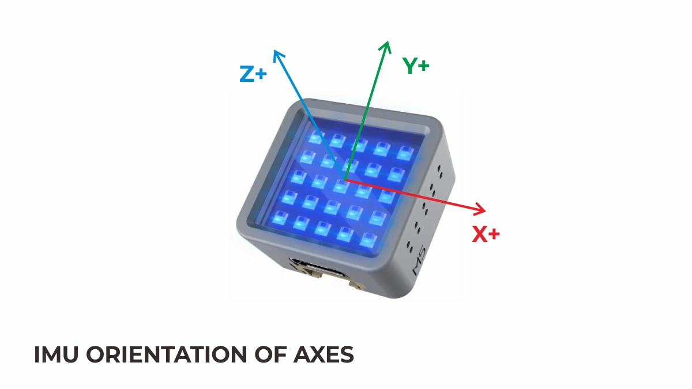

[Source](https://docs.m5stack.com/en/core/ATOM%20Matrix)

## AtomS3 — MPU6886 (0x68)

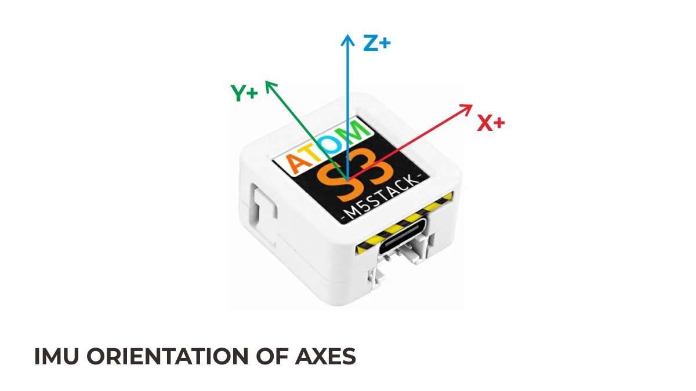

[Source](https://docs.m5stack.com/en/core/AtomS3)

## AtomS3R (+CAM/Ext/M12) — BMI270 (0x68)

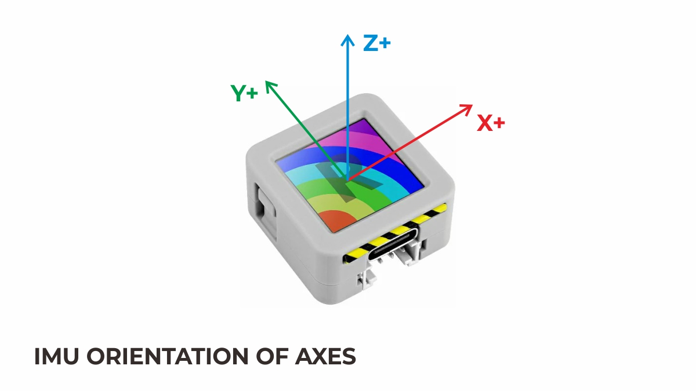

[Source](https://docs.m5stack.com/en/core/AtomS3R)

## StickC-Plus — MPU6886 (0x68)

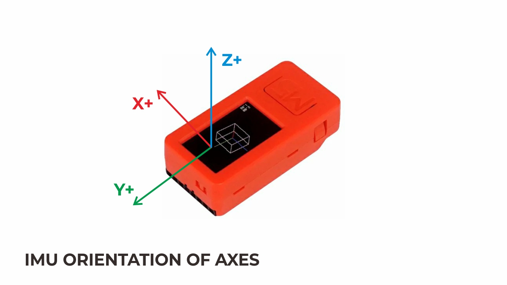

[Source](https://docs.m5stack.com/en/core/m5stickc_plus)

## StickC-Plus2 — MPU6886 (0x68)

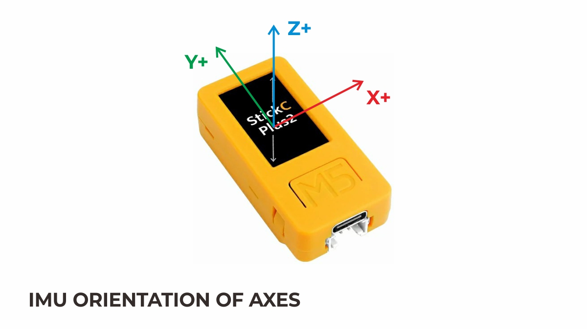

[Source](https://docs.m5stack.com/en/core/M5StickC%20PLUS2)

## StickS3 — BMI270 (0x68)

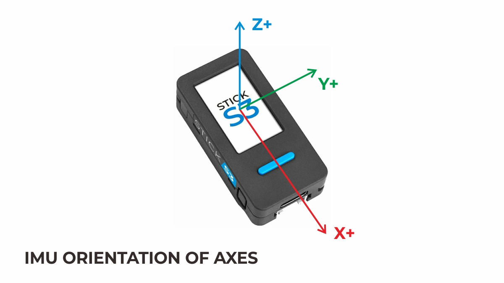

[Source](https://docs.m5stack.com/en/arduino/m5sticks3/imu)

## Capsule — BMI270 (0x69)

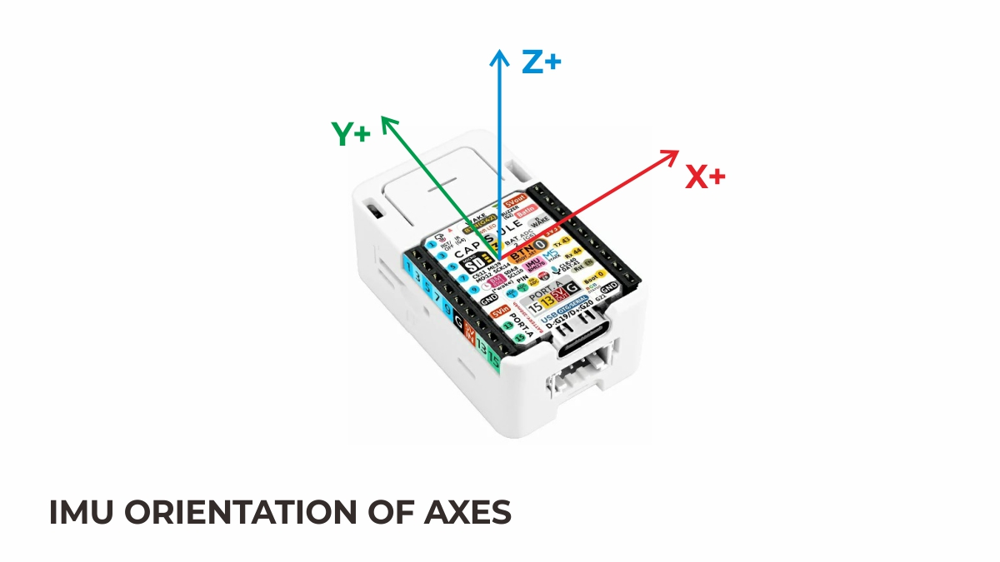

[Source](https://docs.m5stack.com/en/core/M5Capsule)

## PaperS3 — BMI270 (0x68)

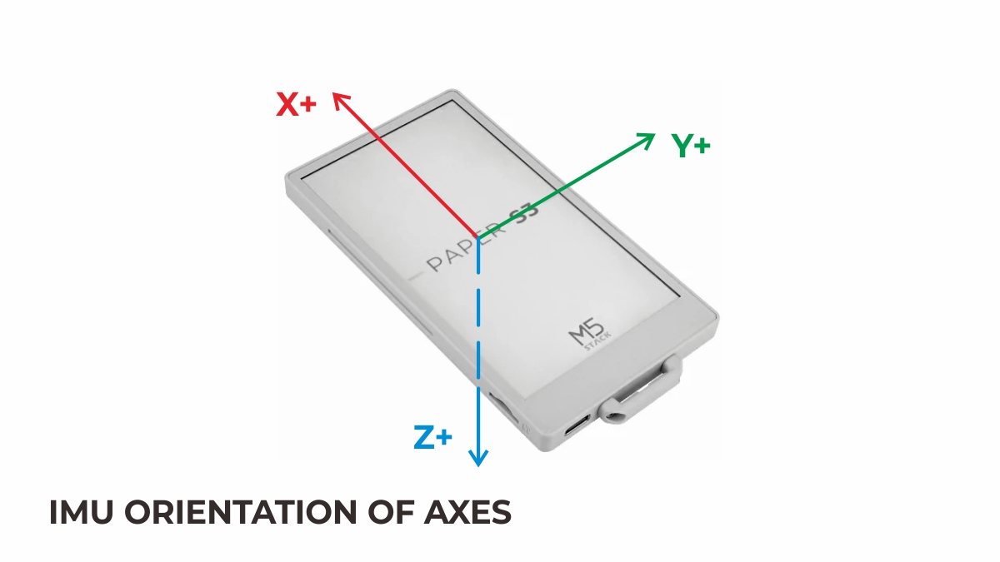

[Source](https://docs.m5stack.com/en/core/papers3)
